# 🚀 WorkSync — Real-Time Team Collaboration Platform

### YOUR TEAM, IN SYNC

**WorkSync** is a team collaboration and project management platform designed to help teams organize projects, manage tasks, coordinate team members, and communicate through group chat in one place.

It provides a centralized workspace where teams can track their work, monitor project progress, and collaborate more efficiently.

---

## 📸 Project Preview

### 🏠 Landing Page

<p align="center">
  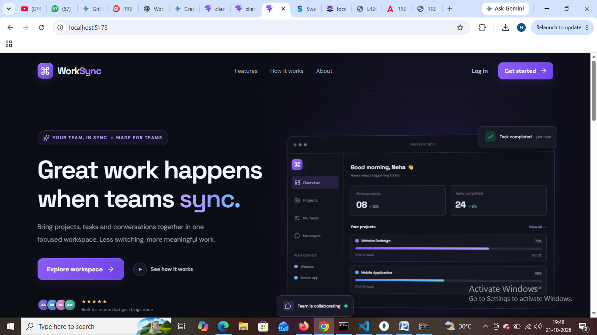
</p>

<p align="center">
  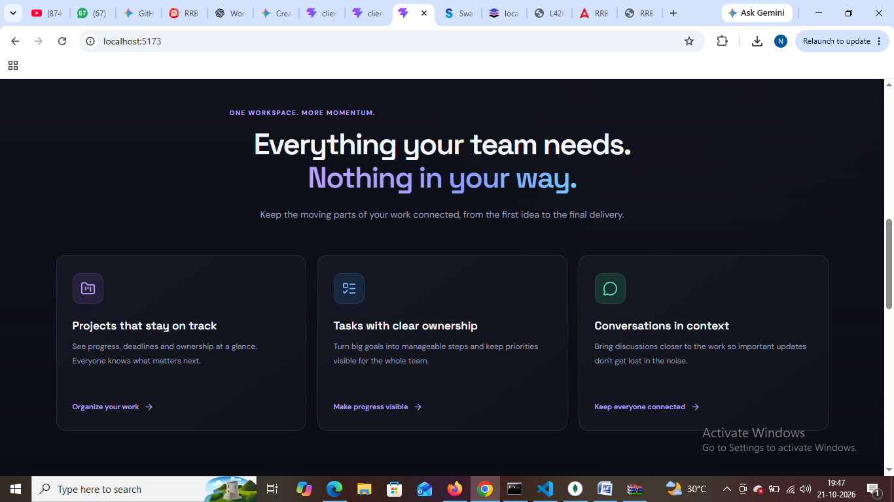
  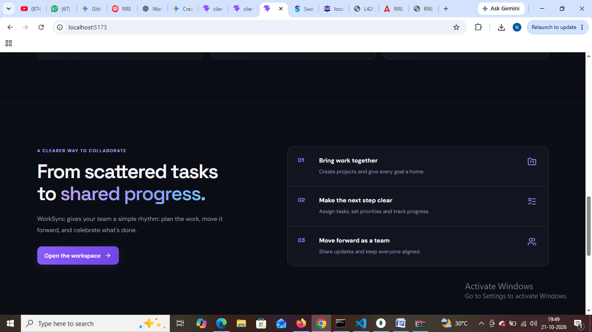
</p>

<p align="center">
  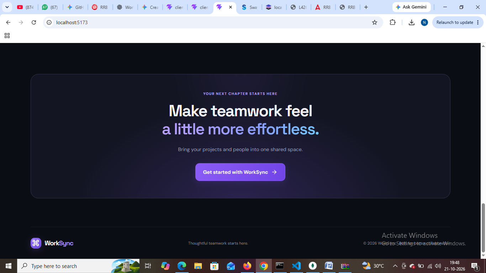
</p>

### 🔐 Login

<p align="center">
  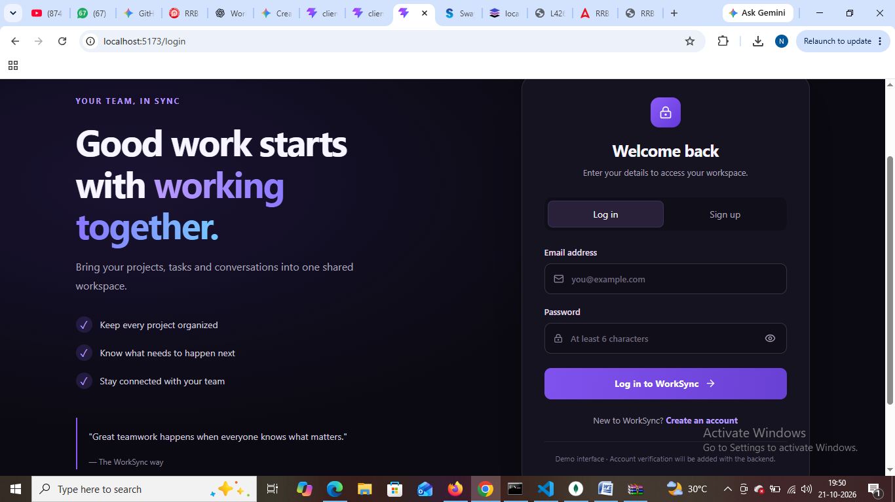
</p>

### 📊 Dashboard

The dashboard provides an overview of the workspace and helps users keep track of their ongoing work.

<p align="center">
  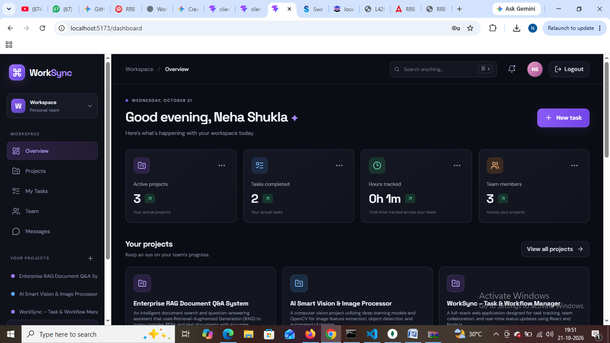
  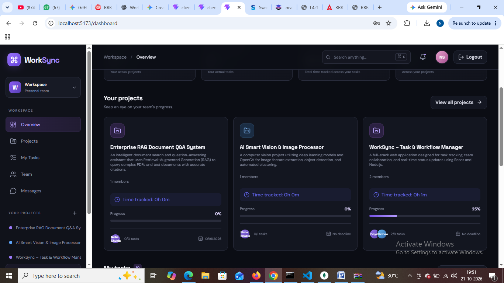
</p>

<p align="center">
  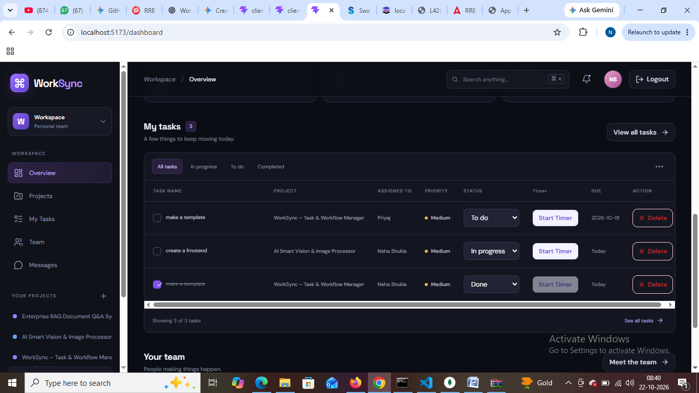
  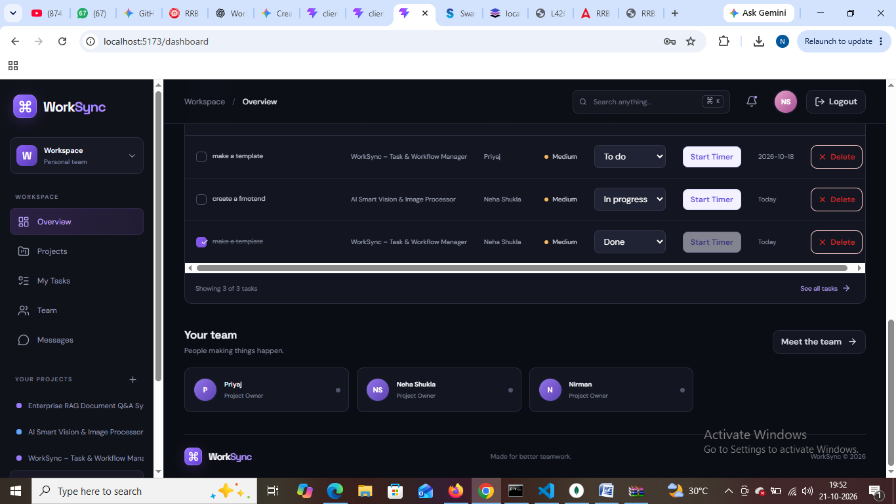
</p>

### 📁 Projects

<p align="center">
  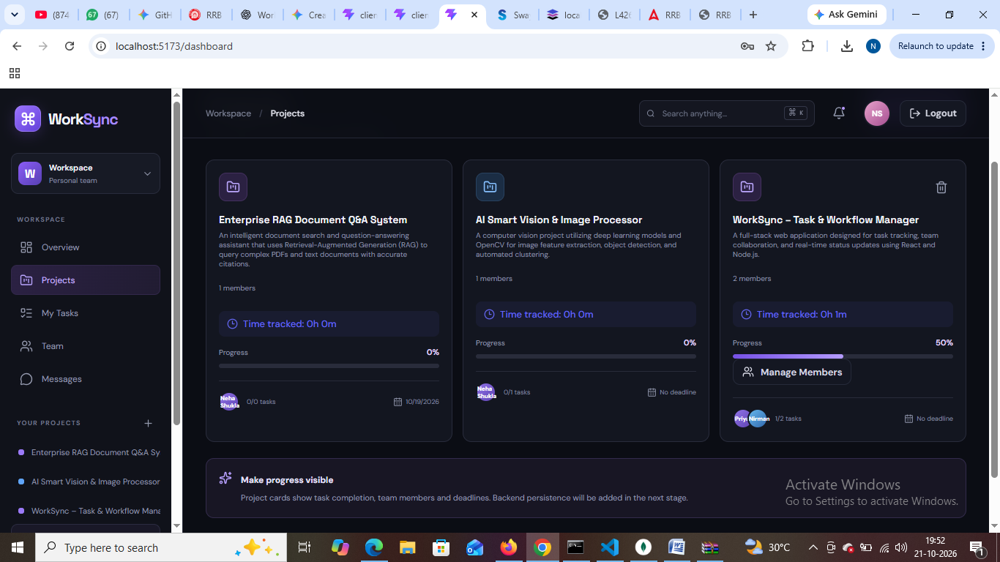
</p>

### ✅ Tasks

<p align="center">
  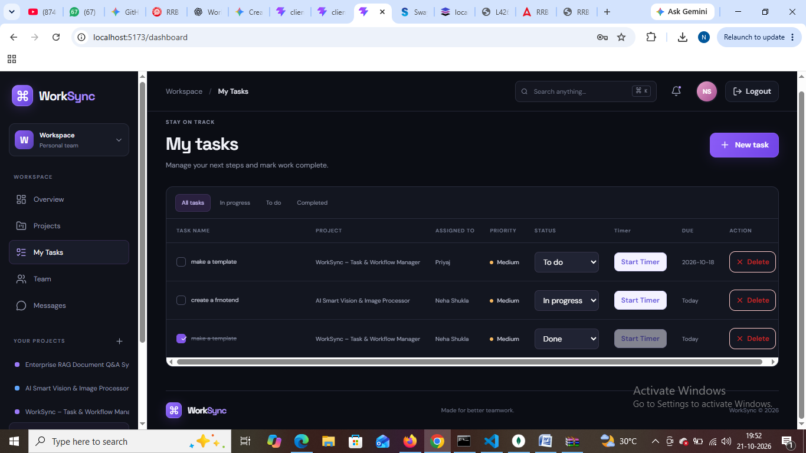
</p>

### 👥 Team

<p align="center">
  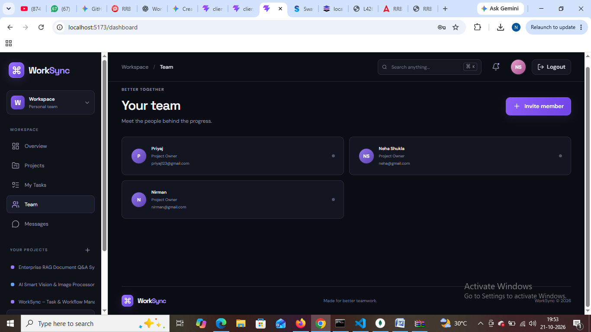
</p>

### 💬 Group Chat

<p align="center">
  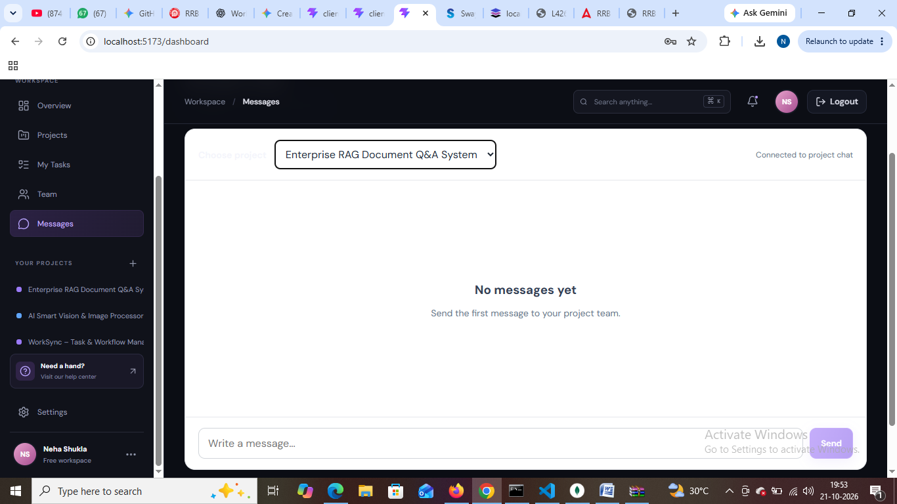
</p>

---

## ✨ Key Features

### 1. 🏠 Landing Page
- **Modern UI:** A clean and professional landing page introducing WorkSync.
- **Hero Section:** Highlights the main purpose of the platform — bringing projects, tasks, and team conversations together.
- **Feature Overview:** Explains the key benefits of using WorkSync.
- **How It Works:** Provides a visual overview of the workflow.
- **Navigation:** Includes links to Features, How It Works, and About sections.
- **Authentication Shortcuts:** Users can navigate to the Login and Sign Up pages directly from the landing page.
- **Call-to-Action Buttons:** Encourages users to get started and access their workspace.

### 2. 🔐 User Authentication
- **User Registration:** New users can create an account using their name, email address, and password.
- **User Login:** Existing users can log in with their registered email and password.
- **Input Validation:** Checks required fields and enforces a minimum password length of six characters.
- **Password Visibility Toggle:** Allows users to show or hide their password while entering it.
- **JWT Authentication:** Uses JSON Web Tokens to authenticate requests to protected backend endpoints.
- **Session Management:** Stores the authentication token and user information in session storage.
- **Protected Dashboard:** Prevents unauthenticated users from accessing the dashboard.
- **Logout:** Clears the stored authentication information and returns the user to the login page.

### 3. 📊 Dashboard Overview
- **Centralized Workspace:** Provides a single place to access projects, tasks, team members, and messages.
- **Project Summary:** Displays the projects available in the user's workspace.
- **Task Statistics:** Shows task completion information, including completed tasks.
- **Tracked Time Summary:** Displays the total time recorded through task timers.
- **Project Progress Overview:** Shows project completion percentages and task counts.
- **Project Deadline Visibility:** Displays project due dates on project cards.
- **Quick Task Creation:** Provides a shortcut for adding new tasks.
- **Workspace Navigation:** Allows users to switch between Overview, Projects, My Tasks, Team, and Messages.

### 4. 📁 Project Management
- **Create Projects:** Users can create projects by entering a project name, description, color, and optional deadline.
- **Project Cards:** Displays each project's name, description, member count, progress, tracked time, task count, and due date.
- **Project Progress Tracking:** Shows the completion percentage of each project visually through a progress bar.
- **Task Completion Summary:** Displays completed tasks against the total tasks associated with a project.
- **Project Deadline Tracking:** Stores and displays project deadlines to help teams monitor upcoming deliverables.
- **Project Color Identification:** Uses project colors to make different projects easier to distinguish.
- **Delete Projects:** Project owners can delete projects after confirming the action.
- **Project Member Management:** Project owners can open the member-management interface to add or remove registered users.
- **Project-Based Organization:** Keeps tasks and team conversations associated with their relevant projects.

### 5. ✅ Task Management
- **Create Tasks:** Users can add tasks to the workspace.
- **Task Details:** Tasks can include a title, associated project, priority, status, and due date.
- **Task Status Management:** Users can change a task's status between `To do`, `In progress`, and `Done`.
- **Task Completion:** A task can be marked as complete or changed back to an incomplete state.
- **Priority Labels:** Tasks display priority levels such as High, Medium, and Low.
- **Due Date Display:** Shows task due dates in the task list.
- **Project Association:** Displays the project associated with each task.
- **Assignee Information:** Displays the assigned user's name or email when available; otherwise, the task is shown as unassigned.
- **Delete Tasks:** Users can delete tasks after confirming the action.
- **Task Filtering and Search:** Helps users find tasks by status and search using task or project information.

### 6. ⏱️ Task Time Tracking
- **Start Timer:** Users can start a timer for a task to record the time spent working on it.
- **Stop Timer:** Users can stop an active timer when they finish or pause their work.
- **Recorded Time:** Stores tracked time against the corresponding task.
- **Total Tracked Time:** Calculates the accumulated time from recorded task sessions and any active timer.
- **Project-Level Time Summary:** Displays the total tracked time associated with a project's tasks.
- **Dashboard Time Summary:** Shows the overall tracked time across tasks.
- **Timer-Based Productivity Tracking:** Helps users understand how much time they spend on individual tasks and projects.

### 7. 👥 Team and Project Members
- **Project Member List:** Displays the members associated with a project.
- **Member Search:** Allows project owners to search for registered users using an email address.
- **Add Members:** Project owners can add registered users to a project.
- **Remove Members:** Project owners can remove members from a project after confirmation.
- **Member Count:** Displays the number of members associated with a project.
- **Member Avatars:** Uses initials-based avatars to represent team members.
- **Access Control:** Backend checks help restrict project operations and project chat access to authorized users.

### 8. 💬 Real-Time Group Chat
- **Project-Based Chat:** Users can communicate in the chat associated with a project.
- **Real-Time Messaging:** Uses Socket.IO to send and receive messages without manually refreshing the page.
- **Message History:** Loads recent messages when a user joins a project's chat.
- **Authenticated Connections:** Requires a valid authentication token to establish a chat connection.
- **Project Access Validation:** Checks whether the user owns or belongs to the project before allowing access to its chat.
- **Message Validation:** Prevents empty messages and limits message length to 2,000 characters.
- **Unread Message Count:** Displays the number of unread messages in the Messages navigation item.
- **Read Status Tracking:** Records which users have read messages when they open the relevant project chat.

### 9. 🔔 Notification Center
- **Notification List:** Displays notifications available to the user.
- **Unread Notifications:** Indicates unread notifications through the notification interface and unread count.
- **Mark as Read:** Allows notifications to be marked as read.
- **Automatic Refresh:** Refreshes notification data periodically while the dashboard is open.
- **Persistent Notification Data:** Retrieves notifications from the backend instead of relying only on temporary frontend state.

### 10. 🔎 Workspace Search and Navigation
- **Search Interface:** Provides a search field in the dashboard interface.
- **Quick Navigation:** Makes it easier to move between workspace sections.
- **Mobile Navigation:** Includes a collapsible sidebar and a mobile menu control.
- **Active Section Indicator:** Highlights the currently selected workspace section.
- **Organized Workspace Layout:** Groups related project, task, team, and messaging functionality in one interface.

### 11. 🔒 Backend and Data Management
- **REST API Integration:** Connects the React frontend to the Express.js backend.
- **MongoDB Database:** Uses MongoDB with Mongoose models to manage application data.
- **Protected API Requests:** Uses JWT-based authentication for protected operations.
- **Project and Task Persistence:** Stores project and task data in the database.
- **Message Persistence:** Saves chat messages so recent conversations can be retrieved.
- **Notification Persistence:** Stores and retrieves notification records.
- **Error Handling:** Displays feedback when operations fail or the backend cannot be reached.
- **Ownership and Membership Checks:** Restricts relevant project operations based on the user's relationship to the project.

### 12. 📱 Responsive User Interface
- **Modern Dashboard Design:** Uses cards, progress bars, status labels, icons, and structured tables to organize information.
- **Consistent Navigation:** Keeps the main workspace sections accessible through the sidebar.
- **Mobile Sidebar:** Allows the navigation menu to open and close on smaller screens.
- **Interactive Controls:** Provides buttons, dropdowns, forms, confirmation prompts, and status indicators for common actions.
- **User Feedback:** Displays success or error messages after supported operations.

---

## 🛠️ Tech Stack

### Frontend
- React.js
- JavaScript
- CSS3
- Vite

### Backend
- Node.js
- Express.js

### Database
- MongoDB

### Real-Time Communication
- Socket.IO

---

## 📂 Project Structure

```text
WorkSync/
│
├── client/
│   ├── public/
│   ├── src/
│   ├── index.html
│   ├── package.json
│   └── vite.config.js
│
├── server/
│   ├── models/
│   ├── routes/
│   ├── .env
│   ├── package.json
│   └── server.js
│
├── screenshots/
│   ├── landing-page.png
│   ├── landing-features.png
│   ├── landing-workflow.png
│   ├── landing-cta.png
│   ├── login.png
│   ├── dashboard-1.png
│   ├── dashboard-2.png
│   ├── dashboard-3.png
│   ├── dashboard-4.png
│   ├── projects.png
│   ├── tasks.png
│   ├── team.png
│   └── group-chat.png
│
├── .gitignore
└── README.md
```


---

## ⚙️ Installation and Setup

### Prerequisites

Make sure the following tools are installed:

- Node.js
- npm
- MongoDB

### 1. Clone the Repository

```bash
git clone YOUR_GITHUB_REPOSITORY_URL
```

### 2. Navigate to the Project Folder

```bash
cd WorkSync
```

### 3. Set Up the Backend

```bash
cd server
npm install
```

Create a `.env` file inside the `server` folder and add the environment variables required by your backend.

Start the backend using the script defined in `server/package.json`. For example, if your start script is configured:

```bash
npm start
```

### 4. Set Up the Frontend

Open a new terminal:

```bash
cd WorkSync/client
npm install
npm run dev
```

Open the local URL displayed by Vite in your terminal.

---


## 🔮 Future Improvements

- **Private Messaging:** Enable direct communication between team members.
- **File Sharing:** Allow users to share project-related files and documents.
- **Email Notifications:** Send alerts for upcoming deadlines and task updates.
- **Advanced Progress Reports:** Provide detailed insights into project completion and team productivity.
- **Calendar Integration:** Provide a calendar view to manage task deadlines and project schedules.

---

## 👩‍💻 Author

**Neha Shukla**

---

## 📄 License

This project is open-source and free to use under the MIT License.
